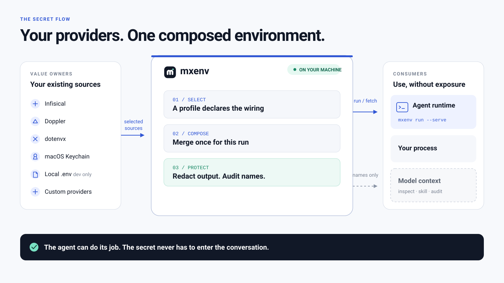

<div align="center">
  <picture>
    <source media="(prefers-color-scheme: dark)" srcset="docs/assets/mxenv-lockup-dark.svg" />
    
  </picture>

### Your secret managers, composed.

**mxenv** adopts the secret managers you already use — Infisical, Doppler, macOS Keychain, dotenvx — composes them per profile, and keeps values out of every prompt.

[Quick start](#quick-start) · [How it works](#how-it-works) · [Security model](docs/guide/security.md) · [Full guide](docs/guide/getting-started.md)

[](https://github.com/Morphicai/morphix-env/actions/workflows/ci.yml)
[](https://www.npmjs.com/package/@morphixai/mxenv)
[](./LICENSE)

</div>

## How it works

A profile selects sources low → high. mxenv loads them only when needed, fails closed on undeclared key collisions, and gives each consumer the narrowest useful surface.



```text
inherited process.env
→ ~/.mxenv/.env           (personal baseline, optional)
→ global default profile  (optional)
→ project profile
→ --env-file override
```

- **No fifth vault** — repository configuration contains wiring, never values; custom stores plug in via `mxenv-provider-*` executables.
- **No silent shadowing** — the same key from two sources is a hard error unless the later source declares `"override": true`.
- **No secrets in the prompt** — inspection, skills, and audit expose key names and provenance only; `run` redacts injected values from forwarded child output.

## Quick start

**With an agent (recommended):**

```bash
npx skills add Morphicai/morphix-env
```

Then tell your agent: *"Set up this project's environment with mxenv."* It inspects and configures the project; nobody pastes a secret value into chat.

**Without an agent:**

```bash
npm install -D @morphixai/mxenv
npx mxenv inspect              # key names, sources, status — never values
npx mxenv doctor               # one-shot health check
npx mxenv run -- pnpm dev      # compose the project profile and run
```

**Untrusted consumers:** keep values out of every process environment and fetch them one at a time — `npx mxenv run --serve -- pnpm dev`, then `npx mxenv fetch KEY` inside the child. See the [security model](docs/guide/security.md).

## Compared

| | dotenv / direnv | dotenvx | Infisical / Doppler CLI | 1Password CLI / Vault | mxenv |
|---|---|---|---|---|---|
| Values live in | plaintext files | encrypted files | provider cloud | the vault | **nowhere new** |
| Composes multiple sources | ✗ | ✗ | own product only | own product only | ✓ any mix + global baseline |
| Same-key collision | silently shadowed | silently shadowed | n/a | n/a | hard error unless `override: true` |
| Agent context hygiene | `cat .env` leaks | partial | `--plain` leaks | `op read` leaks | value-free surfaces; `run` redacts output |

## Documentation

| | |
|---|---|
| [Getting started](docs/guide/getting-started.md) | install paths, first composed run, the editor, shims, packages |
| [Configuration reference](docs/guide/configuration.md) | sources, profiles, precedence, legacy compatibility |
| [Providers](docs/guide/providers.md) | Infisical, Doppler, dotenvx, Keychain, local, plugin protocol |
| [Command reference](docs/guide/commands.md) | every command and flag |
| [Security model](docs/guide/security.md) | redaction rules, `run --serve`, value reveal, honest boundaries |
| [Recipes](docs/guide/recipes.md) | CI, Docker/PaaS, monorepo, agents, MCP injection, rotation |

Embedding or scripting on top of the engine? `npm i @morphixai/mxenv-core` — pure contracts at `@morphixai/mxenv-core/contracts`. This is leakage minimization, not a cryptographic boundary — the [security model](docs/guide/security.md#honest-boundaries) states the limits plainly.

## Upgrading from `morphix-env` / `mx-env`

0.12.x renamed everything to the mxenv family; the 0.13.x window removed the compatibility shims. Old bin names no longer run, `mx-env.config.json` is not read (a rename hint is printed), `mx-env://` references are rejected, and `~/.mx-env/` reads until you run `mxenv migrate --home`. The full mapping and step-by-step upgrade live in the [configuration guide](docs/guide/configuration.md#old-name-compatibility-012x--now).

## Known issues

- `npm install` currently reports high-severity advisories in transitive dependencies of `@infisical/sdk` (e.g. `zod`, `axios`); no fixed upstream release exists yet. They affect the provider client, not the composition engine's value handling.

## License

MIT — see [LICENSE](./LICENSE). Security reports: [SECURITY.md](./SECURITY.md).
