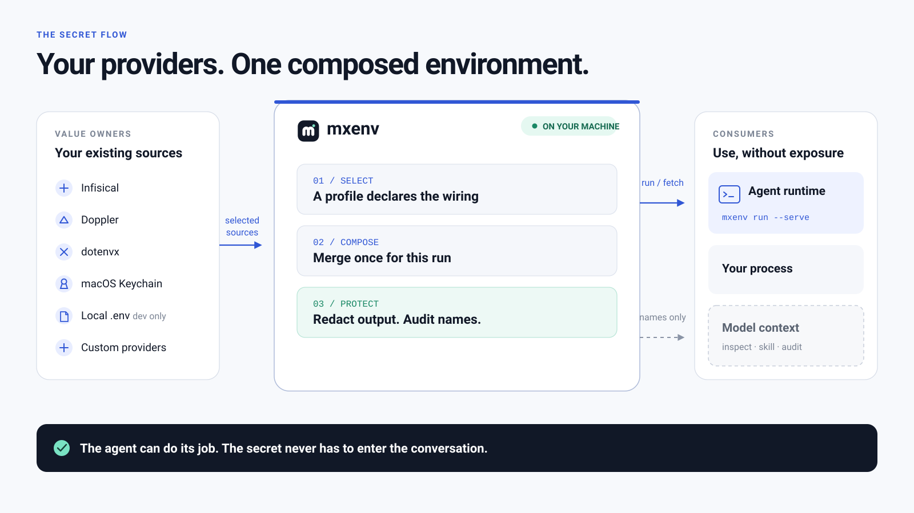
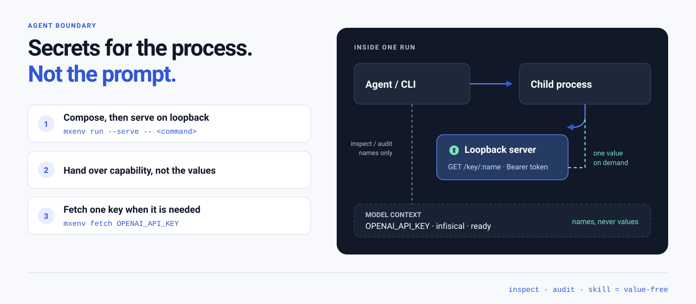
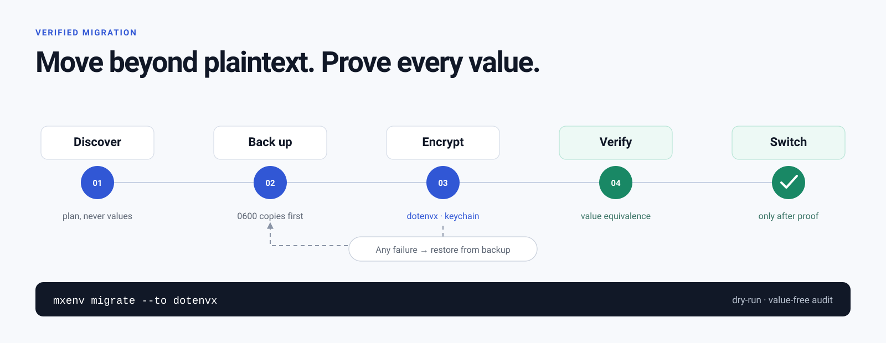

# 从 .env 满天飞，到 Agent 上下文零密钥 —— mxenv 的密钥组合之道

> 状态：宣传正文 v1（2026-11-17）· 本文是对外发布的叙事基准，第九节的承诺清单同时是功能收敛的验收依据
> 配图：[密钥流向](../docs/assets/secret-flow.svg) · [Agent 边界](../docs/assets/agent-boundary.svg) · [可验证迁移](../docs/assets/migration.svg)
> 仓库：<https://github.com/Morphicai/morphix-env> · npm：`@morphixai/mxenv`

---

## 一、老问题：.env 满天飞

每个用过微服务或多端项目的人都熟悉这个剧本：

- 六个子项目共用同一批 `SUPABASE_URL` / `OPENAI_API_KEY`，六个目录各放一份 `.env`，轮换一次密钥要挨个改六处，漏一处就是线上事故；
- 关联费用的密钥躺在明文文件里，`.gitignore` 挡得住 git，挡不住同机任何一个进程；
- 引入 Infisical / Doppler 之后，**single source of truth 有了**，但新问题跟着来：注入方式绑定单一 provider，本地临时覆盖没有优雅出口，CI 里"先 export 再 build"把密钥烘焙进 Docker 镜像。

这一阶段的结论只有一条：**密钥必须有一个所有权清晰的地方**。Infisical 也好、Doppler 也好、macOS 钥匙串也好，值放在谁那里就该由谁管——权限、审计、轮换都是它的职责。

## 二、新问题：Agent 改变了泄露面

Agent 进来之后，剧本又变了。它需要：

1. **跑命令**——`pnpm dev`、测试、构建，都需要带着密钥的环境；
2. **看状态**——这个项目有哪些 key、缺哪个、来自哪个 provider；
3. **改配置**——轮换 token、补一条 key。

传统方案只有两条路，都是坏路：

- **把值贴进对话**：密钥从此躺在聊天记录、模型上下文、可能的日志里；
- **把整个 env 给 Agent**：`cat .env` 或全量注入，授权范围远超任务需要。

**Agent 应该能干活，但密钥永远不必进入对话。**这就是 mxenv 的出发点，也是它和所有"另一个密钥管理工具"的分界线。

## 三、mxenv 是什么：组合层，不是第五个保险库

mxenv 一句话：**secret composition CLI**——把你在用的密钥来源按 profile 组合成一个短命的子进程环境，并且保证 inspect / audit / Agent 上下文里只有键名、没有值。



三条理念，全部写在产品行为里而不是口号里：

**1. 值的所有权不转移。** Infisical、Doppler、macOS Keychain、dotenvx、本地文件——mxenv 一个都不取代，只是按 profile 把它们组合起来。仓库配置（`mxenv.config.json`）里只有接线：provider、路径、顺序，**没有一个值**。

**2. 冲突 fail-closed。** 同一个 key 从两个来源出现，默认直接报错；靠后的来源必须显式声明 `"override": true` 才能覆盖。两个环境的同名凭据静默错选，是密钥管理里最贵的事故。

**3. 每个消费方只拿到最窄的有用面。** 进程拿组合环境或按需单键；Agent 上下文只拿键名与来源；人要看的值走逐键揭示、即用即毁。没有"给我全部"这个选项。

## 四、工作原理

### 组合顺序

```text
继承的 process.env
→ ~/.mxenv/.env          （个人全局基线，可选）
→ 全局默认 profile        （可选）
→ 项目 profile            （或 legacy Infisical 配置）
→ -f 覆盖文件             （显式指定）
```

profile 里 source 从低到高排列，`extends` 可以复用别的 profile，`optional: true` 容忍缺席。组合结果只服务这一次运行，进程退出即消失。

### `run` 是唯一注入路径

`mxenv run -- pnpm dev` 组合环境、启动子进程，并**把注入值从子进程输出里实时脱敏**（`[REDACTED]`）——包括跨流式 chunk 的拆分匹配。浏览器公开前缀（`NEXT_PUBLIC_` / `VITE_` / `EXPO_PUBLIC_`）刻意豁免，构建工具需要内联它们。

### `run --serve`：值不进环境

高风险场景下，注入环境本身就是暴露面。`mxenv run --serve -- <command>` 换一种给法：



- 组合后的非公开值**不进入任何进程环境**——子进程、孙进程、`/proc/<pid>/environ` 里都没有；
- 子进程只拿到 `MXENV_ENDPOINT` 和一次性随机 `MXENV_TOKEN`，需要哪个值就 `mxenv fetch <KEY>` 取哪个，一次一个；
- 服务器只监听 127.0.0.1，令牌不出机器，请求与值零日志，子进程退出服务器即销毁。

这个模式对标 aws-vault 的 `--ecs-server`：**交付能力，而不是交付值**。

### `migrate`：明文退场，但每一步都可证明

明文 `.env` 是开发便利，不是存储终态——文件权限防不住同 uid 的 Agent 进程。`mxenv migrate` 把明文搬进 dotenvx 加密文件或 macOS 钥匙串：



每一步先做 0600 备份；加密后**解密回读、与迁移前快照逐值比对**，等价验证通过才改写配置、才删明文；任何一步失败自动还原并在错误信息里如实报告还原结果。全程输出只有键名，没有值。`--dry-run` 出完整执行计划，不落一笔写。

### 需要看值的时候：逐键揭示

人总有要看值的时候（排查、核对）。mxenv 的纪律是：一次一-key、单值驻留（看新的旧的即毁）、审计只记键名。浏览器编辑器（`mxenv edit`）和全局面板（`mxenv gui`）都走同一条 `revealSingle` 能力——**整个工具链只有这一处值揭示实现**，没有旁路。

### 接线可以入仓：`mxenv://profile/KEY`

MCP 配置、dotenv 模板里写引用而不是值，`mxenv inject` 在文件级解析成 0600 输出。配置入仓、值留原地，`op://` 的同款思路。

## 五、Agent 工作流

这是 mxenv 区别于上一代工具的地方。安装打包好的 Agent Skill：

```bash
npx skills add Morphicai/morphix-env
```

然后告诉 Agent："帮我给这个项目配好环境"。Skill 里带着安全红线、五种 provider 的完整 schema、onboarding 流程和排障表——Agent 依此驱动 `inspect`（键名与来源）、`edit`（人在浏览器里操作值）、`run`（带环境执行），**全程没有任何值经过对话**。

人机边界也是显式的：`mxenv gui` 起的本地面板默认锁定，只展示键名与状态；Agent 和脚本永远被限制在 names-only 面，`reveal` / `unlock` 端点只接受人操作的浏览器会话，越权调用会被拒绝并进审计。审计事件本身也是 value-free 的——键名、来源、结果、退出码，仅此而已。

## 六、快速上手

**带 Agent（推荐）：**

```bash
npx skills add Morphicai/morphix-env
# 然后对 Agent 说：帮我用 mxenv 配置这个项目的环境
```

**不带 Agent：**

```bash
npm install -D @morphixai/mxenv
npx mxenv inspect              # 键名 + 来源 + 状态，没有值
npx mxenv doctor               # 一次性体检（命名 / env 钉定 / 来源健康）
npx mxenv run -- pnpm dev      # 组合项目 profile 并运行
```

**CI / 部署**：机器身份走 provider 侧（如 Infisical Machine Identity），mxenv 在运行时拉取组合，不提前生成 `.env`、不烘焙进镜像。可选 `~/.mxenv/.env`（0600）作为个人全局基线，`--no-global` 一键排除。

**终端常客**：`mxenv-cli shell-init` 为声明过的命令生成 PATH shim，之后裸敲 `pnpm dev` 就是 `mxenv run -- pnpm dev`，audit 里 `via: "shim"` 可与 CLI 区分。

## 七、和其他方案比

| | dotenv / direnv | dotenvx | Infisical / Doppler CLI | 1Password CLI / Vault | **mxenv** |
|---|---|---|---|---|---|
| 值存放在 | 明文本地文件 | 加密本地文件 | provider 云端 | 保险库 | **不新增存放地**——以上全部保持值所有者身份 |
| 多来源组合 | ✗ | ✗ | 仅自家产品 | 仅自家产品 | ✓ 一个 profile 混编任意来源 + 全局基线 |
| 同 key 冲突 | 静默遮蔽 | 静默遮蔽 | n/a | n/a | 硬报错，除非显式 `override: true` |
| Agent 上下文卫生 | `cat .env` 泄露 | 部分 | `secrets --plain` 泄露 | `op read` 泄露 | inspect / audit / 编辑器全程无值；`run` 转发输出实时脱敏 |
| provider 自带的身份 / 审计 / 轮换 | — | — | ✓ | ✓ | ✓ 保留原样，mxenv 不接管 |

选 Infisical 还是 Doppler 依然是你要做的决定——身份、权限、审计、价格都在 provider 那边。mxenv 只是把"用哪个"从代码里解耦出来，放进一份可入仓的接线配置。

## 八、诚实的边界

mxenv 做的是**泄露最小化，不是密码学边界**：

- 拿到值的进程仍然可以故意外传它；高风险 Agent 能力应该用 provider 侧的 proxy/broker 单独设计，而不是硬塞进 `run`；
- `--serve` 的能力令牌经由环境传递，Linux 上同 uid 进程可通过子进程 `/proc` 读到它——这与 aws-vault `--ecs-server` 的固有属性相同；值本身不出现在任何进程环境里；
- `mxenv://` 引用解析没有转义：组合值里恰好出现该模式的文本也会被当作引用，需要字面量时请改写存储值。

把边界写清楚，比假装完美更值得信任。

## 九、路线图与承诺（功能收敛依据）

以下清单是本文对外承诺的全部范围，也是后续功能工作的验收基准。**本文承诺的，清单里有；清单外的，本文不提。**

**已交付（截至 0.16.0）**

- [x] 五 provider 组合 + plugin 协议（`mxenv-provider-<name>` 任意可执行文件即 provider）
- [x] `run` 输出实时脱敏（含流式 chunk、≤2 字符值豁免规则）
- [x] `run --serve` 按需取值 + 一次性令牌 + 随子进程销毁
- [x] `inspect` / `audit` / `doc` 全程无值；Infisical env 钉定状态直接标注在 inspect 源行上
- [x] `doctor` 一次性体检：命名、env 钉定、来源健康、短值碰撞、明文残留、旧全局目录——全部发现一次报出，exit 1 即 CI 可用（0.16.0）
- [x] 会话式浏览器编辑器（`edit`）与逐键揭示（`revealSingle` 唯一实现）
- [x] `migrate`：0600 备份 + 值级等价验证 + 失败自动还原（dotenvx / keychain 双目标）
- [x] 终端 shim（`shell-init`，`via: shim` 审计区分）
- [x] 会话式本地面板（`mxenv gui`：默认锁定、人机边界、4h 会话）
- [x] Agent Skill 分发（`npx skills add` + npm 包内同版 SKILL.md）
- [x] 三包分层：`@morphixai/mxenv`（运行面）/ `mxenv-cli`（全局管理面）/ `mxenv-core`（L0+L1 SDK）

**承诺中（按优先级）**

- [ ] **跨平台 keychain**：os-keychain 目前 macOS-only；补 Windows Credential Manager 与 Linux Secret Service 路径
- [ ] **keytar 替代**：上游已归档，评估 `@napi-rs/keyring` 或维护 fork，消除安装期告警
- [ ] **面板常驻化**：`gui` 会话已有，launchd 托管 + 稳定端点消费者随真实需求落地（契约零变更）
- [ ] **remote source 真编辑**：Infisical / Doppler 的键值编辑目前跳转 provider 自己的 UI，改为经 provider API 就地编辑

**明确不做**

- 不做新的密钥存储/托管（这是定位，不是缺陷）
- 不做值的浏览器同步或云端面板（值不出机器是红线；云侧只允许无值拓扑）
- 不在 0.x 阶段承诺跨 minor 无破坏升级（破坏性变更会在 CHANGELOG 醒目标注）

## 十、结语

环境变量管理不是一个高深问题，但它"不解决就一直烦你"。每一代工具都在回答同一个问题：**值放在哪、谁能拿到、拿的时候留下什么痕迹**。

上一代的答案是"放进云保险库"。Agent 时代的答案应该是：值留在原处，进程按需取用，**对话里永远只有键名**。

- 仓库：<https://github.com/Morphicai/morphix-env>（MIT）
- npm：[`@morphixai/mxenv`](https://www.npmjs.com/package/@morphixai/mxenv)
- 上手：`npx skills add Morphicai/morphix-env`，然后对 Agent 说——"帮我用 mxenv 配置这个项目。"
