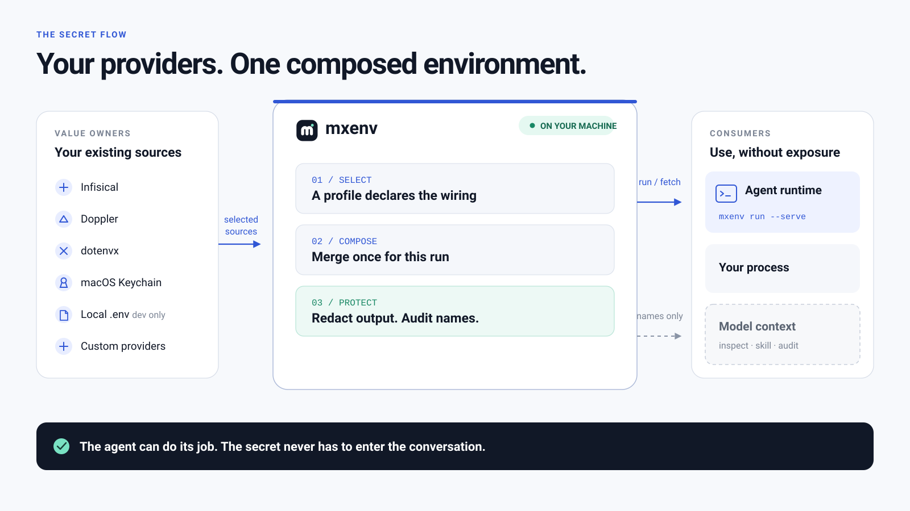

# Getting started

mxenv composes the secret sources you already use into a short-lived environment for processes — or serves values to agent runtimes on demand. Providers (Infisical, Doppler, the OS keychain, dotenvx, local files) keep owning their values; repository configuration contains wiring, never values.

This guide gets you from zero to a composed run. For the full schema see [Configuration reference](./configuration.md); for per-provider auth see [Providers](./providers.md).

## How it fits together

Providers keep owning their values. A profile selects sources; mxenv composes them on your machine; agents, processes, and code consume through controlled paths.



## Install

**With an agent (recommended)** — install the packaged skill and let the agent do the rest. It carries the safety rules, the full configuration schema, onboarding, and troubleshooting:

```bash
npx skills add Morphicai/morphix-env
```

Then tell your agent: *"Set up this project's environment with mxenv."*

**Without an agent** — install the run face as a project devDependency:

```bash
npm install -D @morphixai/mxenv
npx mxenv inspect          # key names, sources, status — never values
```

**Optional global management face** (terminal shims, panel session):

```bash
npm install -g @morphixai/mxenv-cli
```

> ⚠️ Never install `@morphixai/mxenv` and `@morphixai/mxenv-cli` globally side by side — both register the `mxenv` bin and the later install silently takes over the symlink. Project devDependency for `mxenv`, global for `mxenv-cli` (or the reverse, never both).

## Configure a project

Create `mxenv.config.json` at the project root. It declares **wiring only — never values**:

```jsonc
{
  "sources": {
    "team":   { "provider": "infisical", "paths": ["/ai/api"] },
    "local":  { "provider": "local", "files": [".env.local"], "optional": true, "override": true }
  },
  "profiles": {
    "dev": { "sources": ["team", "local"] }
  },
  "defaultProfile": "dev"
}
```

Profile sources stack low → high. The same key from two sources fails closed unless the later source declares `"override": true` — see [Configuration reference](./configuration.md#precedence).

## First run

```bash
npx mxenv inspect              # what is configured, what is missing — no values
npx mxenv doctor               # one-shot health check (naming, env pins, sources)
npx mxenv run -- pnpm dev      # compose the project profile and run
```

`run` is the only injection path. Injected values are redacted from the child's forwarded output, and every non-injection command stays value-free.

## Personal global baseline (optional)

Create `~/.mxenv/.env` (chmod 600) for machine-wide defaults. It joins every run at the lowest precedence unless `--no-global`. Move it into encrypted storage with `mxenv migrate --to dotenvx` — composition sniffs the encryption markers automatically. See [Providers → dotenvx](./providers.md#dotenvx).

## Edit values

Values are edited by you in the browser, never through the terminal or an agent:

```bash
npx mxenv edit                 # open the management panel scoped to this project
```

Browse key names per source, reveal a stored value one key at a time on explicit request, add/edit/delete keys, switch sources. Remote sources route to their provider's own UI. On macOS the editor opens automatically; the URL is not printed unless `--print-editor-url`.

## Higher-risk agent runs

When the consumer is an agent you do not trust with full environment contents, keep values out of every process environment:

```bash
npx mxenv run --serve -- pnpm dev
# inside that child, fetch values on demand:
npx mxenv fetch OPENAI_API_KEY
```

The child receives only a loopback endpoint and a random run-scoped token. See the [security model](./security.md#on-demand-values-run---serve).

## Terminal shims (optional)

For commands you run constantly, shims remove the `mxenv run --` prefix:

```jsonc
// mxenv.config.json or ~/.mxenv/config.json
{ "shims": ["node", "pnpm"] }
```

```bash
mxenv-cli shell-init           # generate shims, print the PATH line
mxenv-cli shell-init --write   # also maintain a marked rc block
```

After the PATH line is active, `pnpm dev` is exactly `mxenv run -- pnpm dev` — same composition, same redaction, same exit code.

## Next steps

- [Configuration reference](./configuration.md) — every source type, profile semantics, precedence
- [Providers](./providers.md) — login, machine identities, dotenvx key bootstrap, plugin protocol
- [Command reference](./commands.md) — every command and flag
- [Security model](./security.md) — redaction rules, on-demand values, honest boundaries
- [Recipes](./recipes.md) — CI/CD, Docker/PaaS, agents, key rotation
