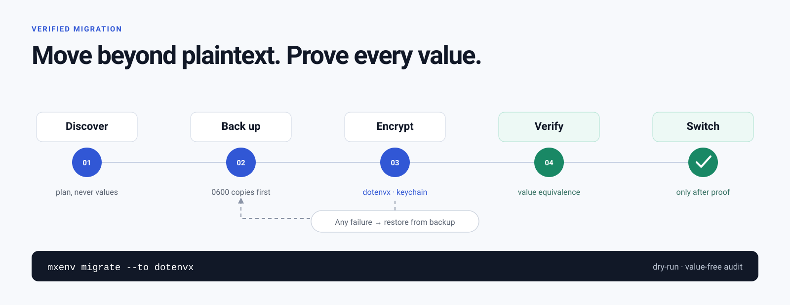

# Recipes

Concrete setups for the environments mxenv is used in. Schema details live in the [Configuration reference](./configuration.md); provider auth in [Providers](./providers.md).

## Agent-first workflow

The preferred install carries the whole workflow as a skill — safety red lines, the full schema, onboarding, troubleshooting:

```bash
npx skills add Morphicai/morphix-env
```

Then drive it conversationally: *"Set up this project's environment with mxenv."* The agent inspects (`mxenv inspect` — names only), writes `mxenv.config.json` (wiring only), and opens `mxenv edit` for you to fill values in the browser. No value ever passes through chat. For untrusted agents running commands, use `run --serve` so values stay out of every process environment — see the [security model](./security.md#on-demand-values-run---serve).

Generate a per-project agent cheat sheet with `mxenv doc` — a value-free key→source table at `.agents/skills/mxenv/SKILL.md`.

## CI / CD

Machine identity on the provider side; composition at run time; no `.env` files, no baked secrets:

```yaml
# GitHub Actions job
env:
  INFISICAL_CLIENT_ID: ${{ secrets.INFISICAL_CLIENT_ID }}
  INFISICAL_CLIENT_SECRET: ${{ secrets.INFISICAL_CLIENT_SECRET }}
  INFISICAL_PROJECT_ID: ${{ secrets.INFISICAL_PROJECT_ID }}
  DEPLOY_ENV: prod
steps:
  - run: npm ci
  - run: npx mxenv run --no-global -- npm test       # project profile only
  - run: npx mxenv run --no-global -- npm run build
```

- `--no-global` keeps CI runs reproducible: project profile only, no developer's machine-wide baseline.
- Provider credentials (`INFISICAL_CLIENT_*`) are the only platform-configured secrets — everything else is composed at runtime.
- For values needed at image runtime rather than build time, compose in the container entrypoint (`mxenv run -- node server.js`); never `infisical export > .env && docker build`, which bakes secrets into layers.

## Docker / PaaS (Zeabur, Railway, Fly.io, …)

Platforms that build a Dockerfile directly offer no pre-build hook — which is exactly why build-time secret files are the wrong shape. mxenv composes at process start:

```dockerfile
FROM node:20-alpine AS builder
WORKDIR /app
COPY . .
RUN npm ci && npm run build          # public keys (NEXT_PUBLIC_*) inline fine — they are public

FROM node:20-alpine AS runner
WORKDIR /app
COPY --from=builder /app/dist ./dist
COPY --from=builder /app/package-lock.json ./
RUN npm ci --omit=dev
CMD ["npx", "mxenv", "run", "--", "node", "server/index.js"]
```

The platform only needs the provider-identity variables (e.g. `INFISICAL_CLIENT_ID/SECRET/PROJECT_ID`, `DEPLOY_ENV`) configured once; new application keys are added on the provider and every deployment picks them up on next start.

## Monorepo

Each package keeps its own `mxenv.config.json`; composition resolves from the current working directory, so running from `packages/api` composes that package's profile, and running from the root composes the root's. Shared organization-wide sources live in `~/.mxenv/config.json` (the global layer) and are pulled in via `extends` or the global default profile; exclude them per run with `--no-global` when a package must stand alone.

## MCP config injection

Keep MCP server configs in git without values by writing references, then materializing a private copy:

```jsonc
// mcp.json.tmpl (committed)
{ "mcpServers": { "linear": { "command": "npx", "env": { "LINEAR_API_KEY": "mxenv://dev/LINEAR_API_KEY" } } } }
```

```bash
npx mxenv inject mcp.json.tmpl ~/.config/mcp/mcp.json    # resolves references, mode 0600
```

`run` also resolves `mxenv://profile/KEY` references inside composed values, so a single template serves both patterns. Re-run `inject` after rotations; the committed template never changes.

## Key rotation

1. Rotate in the provider (Infisical dashboard, keychain update via `mxenv edit`, dotenvx value edit) — one place.
2. Consumption points keep **references**, not values: `${NPM_TOKEN}` in `.npmrc`, `mxenv://` in MCP templates — so rotation touches zero consumers.
3. Never keep the same credential in two stores (double custody shadows one side after rotation).
4. Verify with `npx mxenv inspect` (source updated) and a real `run`. The value-free audit journal (`mxenv audit tail`) is the trail.

## Encryption onboarding (`migrate`)

Found plaintext sources (inspect marks them `[plaintext, dev-only]`)? Review the plan, then execute — every step is backed up and value-verified before anything is switched:



```bash
npx mxenv migrate                     # read-only plan: units, files, key names
npx mxenv migrate --to dotenvx        # encrypted files, portable + CI-friendly
npx mxenv migrate --to keychain       # OS keychain personal secrets
```

Every unit gets a 0600 backup and a value-level equivalence check before any config rewrite; failures restore automatically. Distribution of the dotenvx `.env.keys` file is an out-of-band, provider-of-your-choice step (password manager, provisioning) — never chat, never the repository.

## Frontend runtime configuration

Browser-public keys (`NEXT_PUBLIC_*`, `VITE_*`, `EXPO_PUBLIC_*`) are public by definition — they stay in the environment and build tools inline them. For runtime-configurable frontend settings:

```bash
npx mxenv generate --out public/__env.js
```

loads the browser-public composition into a runtime script; rebuilds are not required for value changes.
