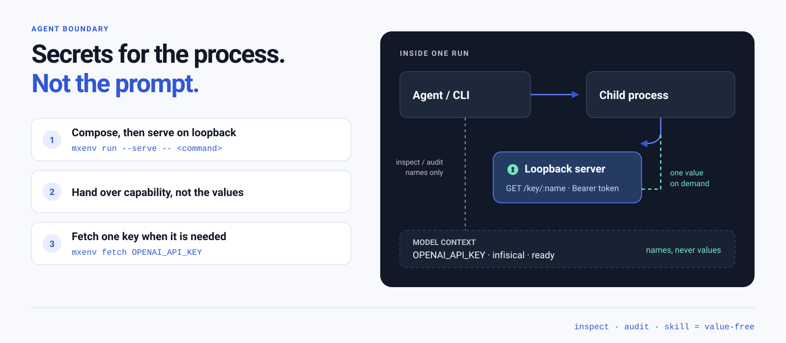

# Security model

mxenv's security story is a set of narrow, auditable surfaces — not a cryptographic boundary. This page states exactly what is protected, how, and where the honest limits are.

## Principles

1. **Values keep their owners.** mxenv never stores values; providers (Infisical, Doppler, Keychain, dotenvx, local files) remain the single source of truth with their own identity, permissions, audit, and rotation.
2. **Wiring without values.** Repository configuration (`mxenv.config.json`) contains provider declarations and ordering only.
3. **Narrowest useful surface per consumer.** Processes get a composed environment or on-demand single keys; agent context gets names only; humans get per-key reveal.
4. **Fail closed.** Same-key collisions error out; plaintext global baselines are rejected without `--allow-insecure-global`; Infisical runs without an explicit environment fail rather than assume.

## What is value-free, always

- `inspect` — key names, source provenance, availability
- `audit` — names, outcomes, exit codes, channels (`cli` / `shim` / `host`), config path
- the packaged Agent Skill and `mxenv doc` output
- editor and panel listings; error messages (provider stderr is never surfaced because it may contain sensitive material)
- `migrate` plans and reports

## Output redaction (`run`)

`run` is the only injection path, and it redacts every injected value from the child's forwarded stdout/stderr — including matches that arrive split across stream chunks. Rules:

- Browser-public prefixes (`NEXT_PUBLIC_`, `VITE_`, `EXPO_PUBLIC_`) are exempt by design: build tools must inline them.
- Values of 1–2 characters are exempt (they carry no meaningful entropy, and substring-redacting them corrupts protocol data carried over stdio — e.g. MCP revision/digest round-trips).
- 3–4 character values redact, with a stderr warning about collision risk; mxenv suggests moving such config-shaped values out of secret sources.
- The redaction set never uses shape heuristics — source provenance defines secrecy, not "does it look like a token".

## On-demand values: `run --serve`

`mxenv run --serve -- <command>` (modeled on aws-vault's `--ecs-server`) keeps composed non-public values out of every process environment — the direct child, descendants, `/proc/<pid>/environ`, core dumps:

- The child receives only `MXENV_ENDPOINT` (loopback, random port) and a random run-scoped `MXENV_TOKEN`.
- Values are fetched one at a time: `mxenv fetch <KEY>` or `GET /key/<KEY>` with `Bearer` auth. `401` without the token, `404` for unknown keys; no request or value is ever logged.
- The token itself is redacted from child output like any injected value.
- The server shares the child's lifetime and is destroyed the moment the child exits — no listener outlives the run.
- Only keys composed by mxenv are withheld; variables already exported in the invoking shell pass through unchanged. Browser-public prefixes stay in the environment so build tools can inline them.

**Honest caveat:** an environment-delivered token is readable by same-uid processes on Linux via the child's `/proc` — the same inherent property as aws-vault's server. The *values* themselves appear in no process environment anywhere.

## Value reveal: one key, one resident, one audit line

Every "show me this value" surface (editor, panel) goes through a single core capability, `revealSingle`:

- one key at a time, on explicit request
- one resident value per session slot — revealing a new key evicts the previous one; short residence TTL; explicit release on close
- default-locked states reject reveal without an explicit authorization context
- a value-free `reveal` audit event per request (success / locked / not-found / read-error)

When the consumer is an agent, prefer `run --serve` — the agent fetches values one at a time over loopback, and nothing plaintext ever enters the conversation or any environment.

## Human/machine boundary (panel)

`mxenv gui` serves a machine-level keys view where `/reveal`, `/unlock`, `/lock`, `/set`, and `/delete` require both the Bearer session token and the `x-mxenv-panel: 1` consumer-boundary declaration. Ordinary API automation is confined to the names-only surface; rejected reveal/unlock/write attempts are audited. The names-only surface includes external providers such as Infisical/Doppler and returns key/source/provider metadata without values; one unavailable source is isolated from the others. External reveal uses the same scope-constrained `revealSingle` path as local storage and returns one value with `Cache-Control: no-store`; the UI hides it after 90 seconds. This declaration expresses the intended human-panel route — it is not authentication against a malicious same-user process; loopback binding and the 0600 runtime file remain the actual token boundary. Sessions: 4-hour TTL and 30-minute idle auto-close for one-shot servers; installed daemons have no wall-clock expiry and idle only locks. Unlock windows: 15 minutes against the wall clock, 5-minute idle auto-lock that only explicit actions extend. The session token lives in `~/.mxenv/host/runtime.json` (0600, created and cleared with the session).

The React panel HTML contains no token or serialized API state. Its generic bundle derives the token from the current path and never persists it; content-addressed JS/CSS requests recheck the token and bundle hash, JavaScript carries SHA-256 integrity, and CSP is enforced by the response header with no external origins. Locking, switching scopes, or opening another sensitive action invalidates in-flight reveals as well as clearing rendered values and form state.

Panel writes are deliberately narrow: `local` dotenv files, `dotenvx` encrypted files, and keys already declared by an `os-keychain` source. Infisical, Doppler, plugin, and other remote providers stay read-only in this panel. Every set/delete writes a value-free audit event (`via: host`); responses and audit entries never echo the submitted value.

Project wiring edits have a larger blast radius than changing one value: they alter every later `run` composition. `/wiring-preview` is read-only; `/wiring-write` additionally requires an explicit project scope and the fingerprint of the value-free diff shown to the operator. The server recomputes that fingerprint, so a concurrent config change invalidates approval instead of being overwritten. Writes preserve the previous `mxenv.config.json` in a 0600 `.bak` file and roll back on backup or post-write verification failure. Successful and rejected attempts are audited; successful events contain redacted before/after source summaries, never values. Inherited `__mx` sources, global wiring, and remote-provider value writes are not editable through this surface.

**Resident mode** (`mxenv gui install`) trades auto-close for availability: the host runs from login onward under launchd/systemd and its session never expires — idleness locks the panel instead of closing it. The security posture does not change: the server stays loopback-only, the token stays in a 0600 runtime file, and values remain behind the unlock window at all times. Pinning `--port` adds a predictable endpoint; leave it random unless a firewall/proxy setup requires otherwise.

## Verified migration

`mxenv migrate` never rewrites config or removes plaintext on faith: every unit gets a 0600 backup, encryption is verified by decrypting/reading back and comparing against the plaintext snapshot (through `dotenvx decrypt`, never `run`, so a same-named shell export cannot shadow the check), and any failure restores plaintext and config from backup, reporting restoration truthfully. Failure messages stay value-free. Backups remain until you delete them.

## Reporting

See [SECURITY.md](../../SECURITY.md) for vulnerability disclosure. Please do not report secrets exposure through public issues.

## Honest boundaries

These are deliberate scope statements, not oversights:

- **Leakage minimization, not cryptography.** A process that receives a secret can still transform or exfiltrate it deliberately. For a high-risk agent capability, use a provider-side proxy/broker as a separate security design rather than passing that credential through `run`.
- **Same-uid processes are not walled off.** The guarantees are the narrow surfaces, default locks, per-key exposure and full audit — not process isolation. An `--serve` token is readable via the child's `/proc` on Linux (inherent to environment-delivered capability tokens).
- **`mxenv://` resolution has no escaping.** Any composed value containing the pattern is treated as a reference on `run` / `export` / `render` / `generate`. To deliver such text literally, alter the stored value before composition.
- **Redaction is substring-based.** It protects forwarded output from accidental echo; it cannot prevent a process from printing a value it deliberately decodes around the redaction set.
