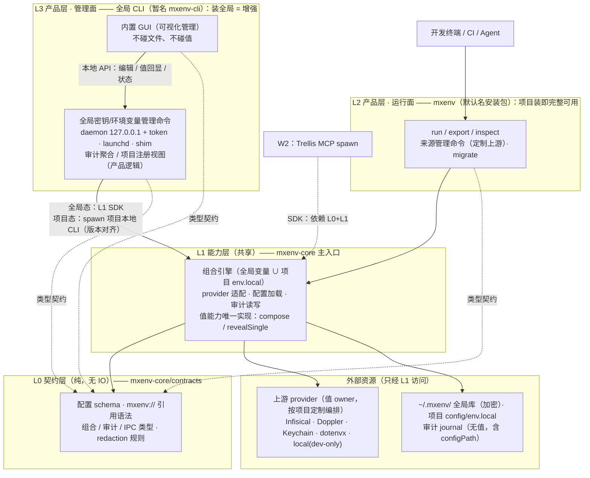

# mxenv UX 与架构升级：解决什么问题，怎么解决

> 状态：架构基准（分层 L0–L3 + 三条产品要求已对齐；Wave A 实施 change：`mxenv-package-split`/`mxenv-naming-cutover`/`mxenv-home-migration`，实施与本文逐条互校） · owner：morphix-env
> 边界：本文只覆盖本仓产品方向；Trellis 侧 `mxenv://` 消费实施见 Trellis 仓 change `mx-env-secret-source`。
> 更新：2026-11-07

## 一、解决什么问题

当前 morphix-env 的组合/加密/审计底座是好的（0.11.0 五次发版打磨的），但**产品体验和形态**有五个具体问题：

1. **没有统一入口，且"必须启动才能看"**。想看任何密钥状态都要从终端起一次性编辑会话（15 分钟 TTL、随机 token、开浏览器），看完即废。来源散在 dotenvx / macOS Keychain / Infisical / Doppler / local 四五处，没有上帝视角。
2. **命名不好**：`mx-env` 带连字符，命令敲起来别扭、品牌不响；`morphix-env` / `mx-env` / `~/.mx-env/` / `mx-env.config.json` 多个名字并存。决定统一为 **`mxenv`**。
3. **管理面体验弱**：想管理"上游"（provider 登录态、来源编排、profiles）和编辑键值，只有 CLI + 一次性编辑器，没有面板级的总览、健康检查和连续操作。
4. **开源门面缺 icon**：现 logo 是通用无限环渐变图（无 `mx` 识别、无密钥/组合语义，仅 PNG 无 SVG 源）。
5. **开源文档不完整**：仓库已 PUBLIC、npm 挂 MIT，但缺 LICENSE 文件、SECURITY.md（密钥工具必须有漏洞披露渠道）、CONTRIBUTING 与 issue/PR 模板。

随之而来的**架构问题**：要做到"随时可看"就必须有常驻服务，而常驻进程意味着长驻攻击面——这和现有"短命会话"的刻意安全设计相冲突。如何常驻、如何守住"值不出机器"是本次升级的核心设计题。

## 二、怎么解决

### 2.0 三条产品要求（验收口径）

| # | 要求 | 架构落点 |
|---|---|---|
| 1 | **项目中安装即可正常使用**：可定制上游（sources 按项目任选编排 provider 与 profile）；可用全局变量，也可用项目级 `env.local` 文件，两者并用 | `mxenv` 项目包独立完整（零机器态）；组合语义：`process.env` → 全局库 → 项目 sources（含 local `env.local`）→ `-f` override；无配置项目默认吃全局库 |
| 2 | **全局 CLI 是增强体验**：更好地管理全局环境变量/密钥，支持可视化管理 | 全局 CLI 叠加管理命令（全局库 list/add/edit/reveal/delete）+ GUI；项目级能力不缩水，装全局只做加法 |
| 3 | **CLI 带 GUI 能力**：GUI 随全局 CLI 分发，一条命令进入可视化管理 | GUI **不独立发包**，作为全局 CLI 内置模块（沿用 editor-ui 打进 CLI dist 的现有模式）；`mxenv gui` 启动 |

### 2.1 品牌与命名（Wave A，BREAKING 一次切）

| 层 | 现状 | 目标 |
|---|---|---|
| CLI bin | `mx-env` / `morphix-env` | `mxenv`（旧名留 alias 一个 minor 周期） |
| npm 包 | `morphix-env` | `mxenv` / `mxenv-core` / `mxenv-cli` 三包（见 2.2） |
| URI scheme | `mx-env://` | `mxenv://`（**抢在 Trellis W2 实施前定案**） |
| 配置文件 / 全局目录 | `mx-env.config.json` / `~/.mx-env/` | `mxenv.config.json` / `~/.mxenv/`（旧名兼容读 + migrate 迁移） |

### 2.2 分层架构：L0–L3，依赖只向下，通用能力下沉

**分层纪律**（用户定调）：严格分层、**上层只依赖下层**；**凡出现第二个使用方的能力，即下沉到更低层共享**；产品差异（命令解析、输出格式、UI）留在上层，不进下层。

| 层 | 内容 | 包 |
|---|---|---|
| **L3 管理面**（产品） | 全局密钥/环境变量管理命令（list/add/edit/reveal/delete）、**内置 GUI**、daemon（127.0.0.1 + token）、launchd、shell-init shim、审计聚合/项目注册视图 | 全局 CLI（暂名 `mxenv-cli`） |
| **L2 运行面**（产品） | 程序的运行（`run`/`export`/`inspect`/`render`/`inject`/`generate`）、来源管理命令（**定制上游**）、`migrate`、`edit`（本地会话式编辑器，含 editor-ui/clientAssets 生成链）、`skill install` | `mxenv`（默认名安装包，devDep / npx） |
| **L1 能力层**（共享） | 组合引擎（**全局变量 ∪ 项目 `env.local`**）、provider 适配、配置加载、审计读写、**值能力 `compose`/`revealSingle`（唯一实现）** | `mxenv-core` 主入口 |
| **L0 契约层**（纯，无 IO） | 配置 schema、`mxenv://` 引用语法、组合/审计/IPC 类型、redaction 规则 | `mxenv-core/contracts` |

包只有三个：**L0+L1 同属 `mxenv-core`**（包内双入口——`/contracts` 给只要类型的消费方，主入口给能力消费方）。分层是逻辑纪律，包是发布单元；层数 > 包数。

**依赖规则**：

```
L3 全局 CLI ──┐            （L3 与 L2 之间零依赖）
              ├──→ L1 能力（mxenv-core 主入口）──→ L0 契约（mxenv-core/contracts）
L2 mxenv   ──┘
```

- 只向下：L3 → L1/L0、L2 → L1 → L0；**两个产品包零依赖**——项目态写操作靠 **spawn 项目本地 CLI** 对齐版本（与 `ensureCommand` "cwd/node_modules/.bin → PATH" 哲学一致），不走包依赖；
- **外部资源（上游 provider、`~/.mxenv/`、项目配置、审计 journal）一律经 L1 能力访问**，上层不直触文件；注册视图的"聚合"逻辑属产品，留 L3；
- 内置 GUI **不碰文件、不碰值**，只说 daemon 的本地 API（类型契约来自 L0）；
- **命令面以 `mxenv` 品牌呈现**：项目装提供 `mxenv`（L2 命令），全局装提供 `mxenv-cli`（L3 管理命令）——"装全局只做加法"。统一命令入口（`gui`/`global`/`host` 并入同一 bin 的可选模块发现）推迟 Wave B 随命令面一起定（design D6）；
- 外部 SDK 消费（W2 Trellis 等）直接依赖 `mxenv-core`（L0+L1）。

**值安全边界**：值能力（组合注入 / 单键揭示）的唯一实现在 **L1（core）**，L2/L3 与外部 SDK 都只是调用方，GUI 永不直连。真实边界是**单一实现 + 窄暴露（compose / revealSingle）+ 全量审计**——同一 uid 下 daemon 进程本就可读文件，靠进程隔离是神话；逐键 reveal、单值驻留、默认锁定、值不落日志/审计/GUI 状态等纪律全部不变。

由此消解两个问题：

- **版本错位**：项目态写操作 spawn 项目本地 CLI（版本对齐）；契约演进由 core 的 semver 约束（additive-only），GUI/daemon/项目包各自节奏升级。
- **仅项目级使用**：`mxenv` 独立完整工作（`npx mxenv …` / npm scripts），管理面是纯增益。终端自动注入与常驻面板天然属于机器级，只在全局安装后提供。

### 2.3 常驻 host + 本地面板（Wave B）

- **daemon**：loopback HTTP（127.0.0.1，每会话一次性 token，文件 0600），launchd 可选托管（`mxenv host install`）+ 手动启动并存。
- **面板**（editor-ui 的常驻化超集）：来源/上游总览（provider 登录态、来源编排、profiles）、键管理与编辑、migrate 入口、审计查看器。
- **安全模型升级**（短命会话 → 常驻但默认锁定）：
  - 面板随时可开，默认**锁定态**只显示键名/状态（names-only 基线不变）；
  - 值回显需显式解锁，沿用**逐键 reveal + 单值驻留**；
  - 空闲自动锁；全部操作进审计（`via: 'host'`）。
- **红线**：值全程不出机器。morphix 云面板（如做）只允许无值拓扑（键名/来源/健康），值操作一律跳回本地面板。

### 2.4 项目注册视图（面板"哪些项目在用"）

**不扫描文件系统。** 注册视图两个源：

1. **审计 journal 派生**（主源）：运行面每次 run/edit 经 L1 写审计（补 `configPath` 字段）→ 全局 CLI 聚合出项目列表：最近使用、频率、通道（cli/shim/管理面）、对账陈旧项（目录消失 → 灰显提示，不自动删）。
2. **`mxenv link` 显式清单**：想钉住的项目手动置顶（含从未 run 过的）。

单一事实源（审计 journal），不维护第三份 registry 状态；版本错位下天然兼容（append-only jsonl，读侧容忍缺字段）。

## 三、架构图



## 四、落地路线（三波）

| 波次 | 内容 | 备注 |
|---|---|---|
| **A 命名与品牌基础** | 改名全切（含 `mxenv://`，同步 Trellis W2 change 文案）+ 三包拆分（`mxenv` / `mxenv-cli` / `mxenv-core`）+ LICENSE/SECURITY | 实施 change：`mxenv-package-split` + `mxenv-naming-cutover` + `mxenv-home-migration`（2026-11-06 立项，替代原 `mxenv-rebrand-layering`）；借 BREAKING 窗口一次迁完；W2 实施前完成 scheme 定案 |
| **B 常驻 host + 面板** | daemon、面板、审计 `configPath`、reveal API、注册视图 | 单独立 OpenSpec change |
| **C 开源收尾 + 1.0** | 新 icon（SVG 源 + favicon + 单色版）、README 重排、gitleaks 历史扫描、blog 收编 | 依赖 A/B |

## 五、决策记录

包组织方式的备选对比（方案 A–E 各自架构图与优缺点、约束对照矩阵）见 [openspec/drafts/organization-alternatives.md](../openspec/drafts/organization-alternatives.md)。

| 决策 | 状态 |
|---|---|
| 查看要值回显（逐键 reveal，否掉仅键名） | 已定（0.11.0 实施） |
| 项目发现不做文件系统扫描，审计派生 + link | 已定（2026-11-06） |
| **分层架构 L0–L3**：上层只依赖下层、通用能力下沉（第二使用方出现即下沉）；包 = `mxenv-core`(L0+L1) / `mxenv`(L2) / 全局 CLI(L3)，产品包零依赖 | 已定（2026-11-06，用户定调分层纪律） |
| **CLI 带 GUI 能力**：GUI 不独立发包，随全局 CLI 分发（`mxenv gui` 一条命令进入） | 已定（2026-11-06） |
| 三条产品要求即验收口径：项目装可用+定制上游+全局变量∪env.local / 全局 CLI=增强 / CLI 带 GUI | 已定（2026-11-06） |
| 全局 CLI 包名（暂名 `mxenv-cli`，发布前最终确认）；统一命令入口的可选模块发现实现推迟 Wave B（design D6） | 待定（Wave B 前定案） |
| 值能力唯一实现在 L1（core，compose/revealSingle 窄暴露），L2/L3 与外部 SDK 只是调用方，GUI 不直连 | 随分层定（2026-11-06） |
| `mxenv-core` 内部分 L0 契约（`/contracts` 独立入口）与 L1 能力两层；`mxenv` 占默认包名 | 随分层定（2026-11-06） |
| 命名全切 `mxenv`（包/bin/scheme/目录），旧名垫片一周期；`mxenv://` 无垫片直切（零存量消费者已实证） | 已定（2026-11-06，随 `mxenv-naming-cutover` 立项） |
| 文档先行 + 实施互校：README/SKILL/本文写目标态，实施期与 design/spec 逐条对照校验 | 已定（2026-11-06，用户工作方式） |
| daemon 托管 launchd 可选安装 + 手动并存 | 待最终确认 |
| 面板红线：值不出机器，云侧只放无值拓扑 | 待最终确认 |
