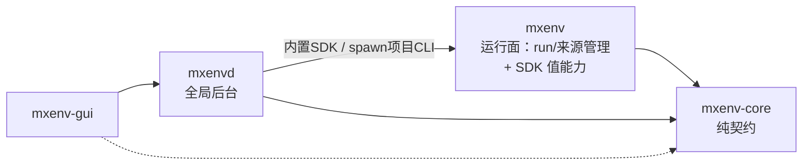
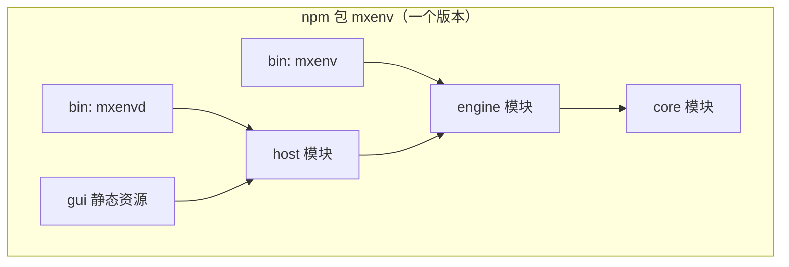
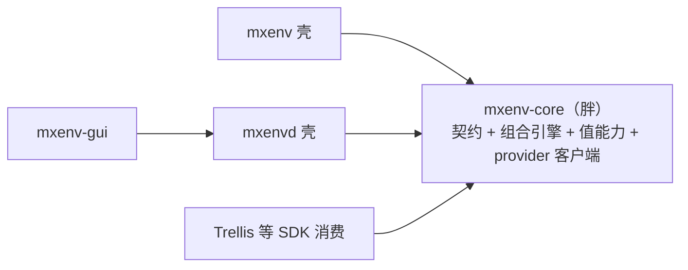
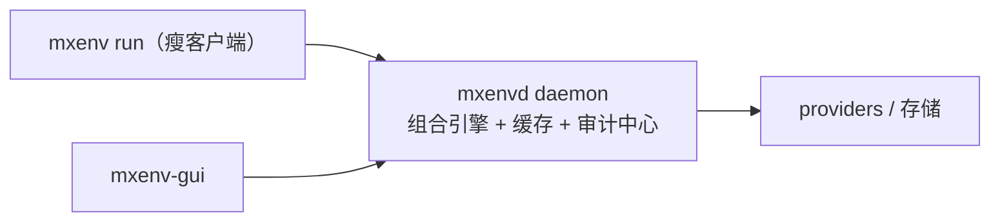
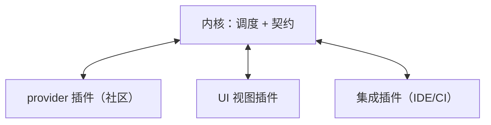

# 包组织方式备选对比（架构图 + 优缺点）

> 状态：备选分析（支撑 `docs/ux-architecture.md` 的两块三包决策） · owner：morphix-env · 2026-11-06
> 后续收敛：按三条产品要求（CLI 带 GUI 能力）GUI 不再独立发包、随全局 CLI 分发——方案 A 由四包收敛为三包（`mxenv` / 全局 CLI / `mxenv-core`），优缺点结论不变。
> 分层定调后（上层依赖下层、通用能力下沉）：结构吸收方案 C 的核心主张——组合/值能力下沉 `mxenv-core`（L1），产品包变薄壳；C 的反对理由（契约不能独立先行）由包内 `/contracts` 双入口化解。`mxenv-core` 实为 L0 契约 + L1 能力两层共享层。
> 五个硬约束：① 仅项目级使用必须正常（npx/无全局/无 daemon）② W2 Trellis 消费 SDK ③ 值短命+无值审计的安全哲学 ④ 开源维护力有限 ⑤ 项目钉版本与全局滚动的版本错位现实存在。

## 方案 A（已采纳）：两块四包 · 契约沉底

`mxenv`（运行面，兼 SDK 值能力）/ `mxenv-core`（纯契约）/ `mxenvd`（全局后台）/ `mxenv-gui`（界面）。

**优点**：边界清晰、依赖单向；契约独立演进（additive semver）；四包按需安装，`npx mxenv` 零机器态；GUI 独立包给远期桌面壳留口；项目态 spawn 本地 CLI 天然版本对齐。
**缺点**：四包发布要有 lockstep 纪律（契约先行、消费方跟进）；`mxenvd → mxenv` 使后台与引擎存在版本耦合面；对外显式包数量多，新用户理解成本略高。

## 方案 B：单包多模块（内部层次）

一个 `mxenv` 包，内部 `src/core|engine|host|gui` 分层，多个 bin（`mxenv`、`mxenvd`）。

**优点**：零版本错位、发布最简、一次安装、依赖树最小；开源新手最容易上手；改一处全链路同版本生效。
**缺点**：模块边界靠约定+lint，长期易被随手穿透（monolith 腐化）；装 devDep 连带 daemon+GUI 代码（安装体积、供应链审计面变大）；想做桌面壳时还是得拆；消费方无法只要引擎。**适合探索期**——但我们已有 4 个清晰边界和 SDK 外部消费者，拆的时机已到。

## 方案 C：胖内核（实现全进 core）

core = 契约 **+ 组合/值能力实现**；`mxenv`/`mxenvd` 变薄壳（纯 argv 转发）。

**优点**：值能力单点最彻底；壳极薄；外部 SDK 消费只依赖一个包。
**缺点**：core 不再"纯"——keytar/dotenvx 等 IO 依赖泄漏给所有消费者；契约与实现同包死锁，契约想独立保兼容就没法先行；重内核任何变更触发全生态升级；违背"core 提供**契约**"的定位。**收益大部分被方案 A 的"mxenv 兼 SDK"覆盖，不值得。**

## 方案 D：daemon 中心化（service-first，Docker 模式）

引擎住在 daemon 里；`mxenv run`/GUI 一切都是 daemon 的客户端；daemon 缓存组合结果、统一审计、后台刷新 provider token。

**优点**：组合缓存大幅提速（每 run 不再冷组合）；中央审计/锁语义完整；provider token 后台续期；CLI/GUI 同一 API 面，产品感最强。
**缺点**：**`run` 依赖 daemon 存活**，直接违反约束①（CI/headless 还得保独立路径 → 双份实现双份维护）；常驻进程持解密缓存，暴露窗口与约束③冲突；故障域变大（daemon 挂 = 开发停摆）。**结论：不能当骨架；远期可作为可选加速层（daemon 在则走缓存，不在则回退独立组合）。**

## 方案 E：插件化（小内核 + 插件生态）

内核只留组合调度；providers、UI 视图、集成全部插件化（延伸现有 `mxenv-provider-<plugin>` 外部可执行协议）。

**优点**：社区加 provider 不用 fork；与既有 provider 插件协议自然衔接；扩展性上限最高。
**缺点**：当前规模属过度设计；插件 API/兼容矩阵是长期税；"任意可执行插件"是持续安全审查面；开源初期最不该背的复杂度。**远期出现第三方 provider 需求再说。**

## 对照矩阵

| 维度 | A 四包 | B 单包 | C 胖内核 | D daemon中心 | E 插件化 |
|---|---|---|---|---|---|
| 仅项目级可用（约束①） | ✅ | ✅ | ✅ | ❌ 需双路径 | ✅ |
| SDK 消费（约束②） | ✅ | ✅ | ✅ 最简 | ⚠️ 须经 daemon | ✅ |
| 值短命哲学（约束③） | ✅ | ✅ | ✅ | ❌ 缓存持值 | ⚠️ 插件审查面 |
| 发布协调成本 | 中（lockstep） | **低** | 中 | 中 | 高 |
| 版本错位处理 | ✅ 契约+spawn对齐 | ✅ 天然 | ⚠️ 全量升级 | ⚠️ | 复杂 |
| GUI 独立演进（桌面壳） | ✅ | ❌ | ❌ | ✅ | ✅ |
| 扩展性 | 中 | 低 | 中 | 高 | **最高** |
| 开源新手友好 | 中 | **高** | 中 | 低 | 低 |
| 迁移成本（自现状） | 中 | **低** | 中 | 高 | 高 |

## 结论

- **A 保持已采纳**：唯一在五个硬约束上全绿的方案，且把 GUI/契约的演进口都留了出来。
- **B 是退路**：若 0.x 期间四包 lockstep 协调实际很痛，收回单包，边界用 lint+目录纪律守——结构上是 A 的坍缩版，方向不会错。
- **C 收益被 A 覆盖**；**D 只配做远期可选加速层**；**E 等第三方扩展需求出现再评估**。

正交选项（与任一方案可组合）：GUI 形态（mxenvd 承载的 web vs 桌面 App 壳）、`mxenvd` 托管（launchd 手动并存 vs 纯手动）——已记录在 `docs/ux-architecture.md` 决策表。
